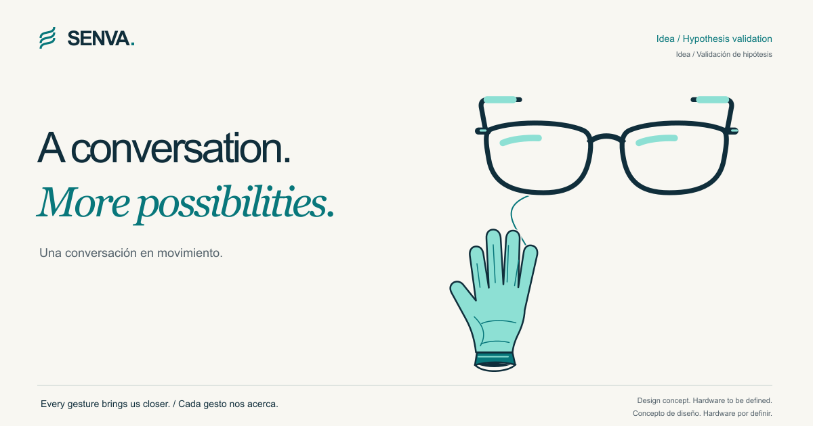

# SENVA

**Cada gesto nos acerca.**

## Que una conversación abra posibilidades.

Compartir una idea. Conocer a alguien. Participar en una conversación espontánea. Esas posibilidades de encuentro motivan SENVA.

Exploramos nuevas formas de contribuir a reducir las barreras de comunicación entre **personas sordas signantes y oyentes**, favoreciendo la autonomía, la participación y la conexión cotidiana.

**[Descubre SENVA en nuestra web →](https://withnolan.github.io/senva/)**

**Estado: Idea / Validación de hipótesis.** Solo existe la idea. Todavía no hemos realizado investigación, entrevistas, un prototipo ni pruebas técnicas. No hay usuarios, clientes, ingresos, patentes ni alianzas confirmadas. SENVA es un proyecto emprendedor, no una empresa constituida.

## La visión: una conversación compartida

Imaginamos un posible sistema de **guantes y gafas para asistir a la comunicación en ambas direcciones**, con la aspiración de conversar sin tener que sostener o colocar un móvil.

Los guantes podrían aportar información manual a la investigación sobre asistencia de lengua de signos española (LSE) a voz o texto, junto con otra información lingüística. Las gafas podrían mostrar subtítulos del habla del interlocutor y aportar sensores adicionales, si se demuestra su utilidad.

Esta visión está por investigar con personas signantes competentes. Reconocer movimientos de las manos no equivale a comprender una lengua: la expresión facial, el cuerpo y el espacio también importan. No prometemos traducción perfecta, universal ni en tiempo real.

## Empezar por las personas

Queremos **codiseñar con personas sordas signantes** para comprender qué necesidades merece la pena abordar y si el hardware propuesto resulta útil y aceptable en su vida cotidiana.

Su participación formaría parte de la definición de las preguntas, el diseño y la evaluación. También queremos escuchar a interlocutores oyentes, docentes y estudiantes adultos de LSE. Este trabajo y estas colaboraciones todavía no han comenzado.

Las situaciones que inspiran el proyecto son puntos de partida para investigar, no testimonios ni necesidades ya validadas.

## Una primera hipótesis: el aprendizaje

> La comunicación es el propósito. El aprendizaje es una primera hipótesis que exploraremos.

Una posible primera aplicación son unos guantes con sensores y una aplicación de práctica para **estudiantes adultos de LSE**. Con docentes, investigaríamos si el feedback sobre ciertos aspectos medibles de la configuración y el movimiento de las manos puede ayudar en ejercicios acotados, como complemento a la enseñanza y al criterio docente.

La pregunta es si ese feedback aportaría suficiente valor para justificar el coste, la calibración y la incomodidad de los guantes frente a cámaras y recursos educativos existentes. Los centros que enseñan LSE serían posibles colaboradores y compradores: una hipótesis que también debemos contrastar.

Un experimento de aprendizaje no demostraría una ruta hacia la traducción de conversaciones naturales. Esa visión necesitaría investigación específica y datos de personas signantes competentes; los datos de principiantes no bastarían.

## Cómo queremos contrastar la idea

1. **Definir juntos la necesidad.** Investigar con personas sordas signantes e interlocutores oyentes qué situaciones merecen atención. Explorar por separado la práctica de LSE con estudiantes adultos y docentes.
2. **Comparar alternativas.** Valorar el hardware propuesto frente a cámaras, móviles y recursos existentes en utilidad, accesibilidad, aceptabilidad, comodidad y coste.
3. **Elegir un primer experimento.** Si la investigación lo justifica, explorar sensores comerciales y unos pocos ejercicios de práctica elegidos con docentes.
4. **Evaluar con las personas.** Contrastar la utilidad y la aceptabilidad del enfoque; en la hipótesis de aprendizaje, valorar el feedback, la calibración y la comodidad con personas distintas.
5. **Decidir con evidencia.** Continuar, cambiar el enfoque o descartar el hardware según lo que aprendamos.

## El equipo

| Cofundador | Ámbito de estudio | Contacto |
| --- | --- | --- |
| **Shengyu Nolan Chen** | Informática y Administración y Dirección de Empresas en la Universidad Carlos III de Madrid (UC3M). | [LinkedIn](https://www.linkedin.com/in/shengyu-nolan-chen/) |
| **Santiago Muñoz Veguillas** | Grado en Diseño y Gestión de Proyectos Transmedia en CSEU La Salle. | [LinkedIn](https://www.linkedin.com/in/santiago-veguillas/) |

Sus ámbitos de estudio ofrecen perspectivas complementarias para explorar la tecnología, la comunicación y el valor de la idea.

Con aportaciones de dos estudiantes colaboradoras durante la fase de ideación.

## Una oportunidad para aprender: Xiji

La web acompaña la candidatura de **Santiago** a Xiji Incubator, Shanghái. Su motivación es ampliar conocimientos y experiencia internacional, conocer el ecosistema emprendedor chino y entender cómo el desarrollo de hardware y el acceso a componentes y proveedores podrían ayudar a explorar el concepto.

El objetivo es aprender a convertir una idea en hipótesis contrastables y un primer experimento. La candidatura no implica admisión, afiliación, respaldo ni compromisos de Xiji o de proveedores.

## Explora el proyecto

- **[Web de SENVA — EN / ES](https://withnolan.github.io/senva/)**: propósito, visión y personas detrás de la idea.
- [Síntesis del proyecto — EN / ES](docs/project-brief.md): concepto, hipótesis y borrador de motivación de Santiago para Xiji.
- [Guía técnica de la web](docs/technical-guide.md): previsualización local, archivos, traducciones, accesibilidad y despliegue.

---

SENVA se inspira en «seña», movimiento y avance. No es un acrónimo. **Cada gesto nos acerca. / Every gesture brings us closer.**
