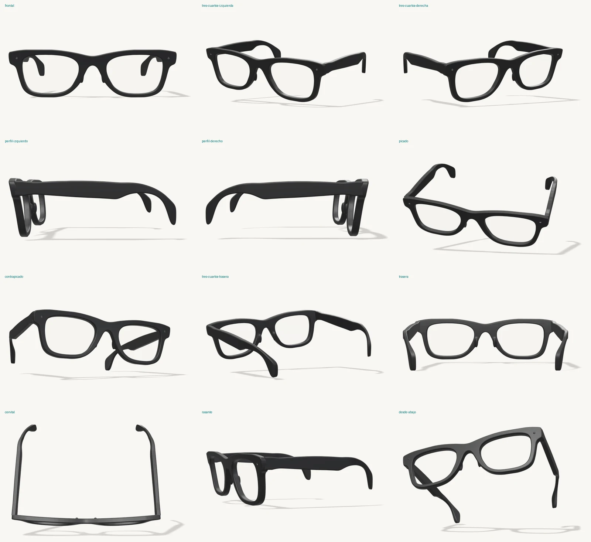

# SENVA — modelos de producto

Recursos de producto. **Las gafas mate están integradas en la visión por petición expresa del usuario**, como concepto; no acreditan un prototipo funcional.

| Modelo | Estado |
| --- | --- |
| [Gafas](#gafas) | Terminado y aprobado por el usuario |
| Guante | Pendiente |

## Gafas

Montura cuadrada de acetato negro, inspirada en una wayfarer y **sin ninguna marca ni logo**. Es simétrica, con caras planas y aristas de ~0,9 mm. El frontal es una placa y las dos patillas son piezas separadas, rectas y unidas en ángulo recto, cada una con su pivote de bisagra.



### Archivos

| Archivo | Uso |
| --- | --- |
| `gafas/senva-gafas.glb` | **Versión web recomendada.** Acabado negro mate. 1,7 MB, ~470 k triángulos, compresión meshopt. |
| `gafas/senva-gafas-brillo.glb` | La misma montura en negro brillo (wayfarer clásica). |
| `gafas/fuente/senva-gafas-maestro.glb` | Maestro sin comprimir (11 MB) para editar en Blender u otras herramientas. No usar en la web. |
| `gafas/vistas/*.webp` | Vistas 2.5D renderizadas, fondo transparente, ~2000 px de ancho y 60–100 KB cada una. |

Vistas disponibles (`gafas-<vista>.webp`): `frontal`, `tres-cuartos-izquierda`, `tres-cuartos-derecha`, `perfil-izquierdo`, `perfil-derecho`, `picado`, `contrapicado`, `tres-cuartos-trasera`, `trasera`, `cenital`, `rasante`, `desde-abajo`. La variante brillo incluye `gafas-brillo-frontal`, `gafas-brillo-tres-cuartos-izquierda` y `gafas-brillo-picado`. Cada vista lleva una sombra de contacto suave incluida en el canal alfa.

### Qué usar

La petición del 23 de octubre autoriza expresamente el GLB mate y sustituye la restricción histórica de no usar 3D para esta pieza. `glasses-3d.js` lo carga de forma diferida en escritorio con puntero preciso, ventana de al menos 1100×700 y sin movimiento reducido. El ángulo gira con el progreso de la visión, sin auto giro; una sola escena se desplaza después al diagrama. La integración posterior añade cristal frío y subtítulos ficticios EN/ES dentro de las lentes mediante materiales/texturas en memoria; el GLB fuente no cambia. La petición posterior añade reflejos orgánicos cambiantes y escritura lenta de cuatro frases por idioma, únicamente con el modelo visible y sin pausa. No son una transcripción real ni una pantalla validada.

La vista `gafas-tres-cuartos-izquierda.webp` permanece como respaldo en el escenario. `gafas-frontal.webp` sustituye al dibujo anterior en el diagrama de subtítulos. Móvil, movimiento reducido, ausencia de JS o WebGL y errores de carga conservan imágenes y contenido HTML. Three.js r169 y Meshopt se sirven localmente con licencia y procedencia en `assets/vendor/three/README.md`. No se cargan la variante brillo ni el maestro.

### Datos técnicos del GLB

- **Escala y ejes:** la geometría está en mm y el nodo raíz `gafas-senva` aplica escala 0,001, así que en escena mide 0,147 × 0,042 × 0,116 m. El eje +Y va hacia arriba y el frontal mira hacia +Z. **El origen no está centrado**: centra el modelo con `Box3`.
- **Derecha/izquierda:** el lado `-derecha` es el +X, es decir, el que queda a la derecha de quien mira las gafas de frente.

| Nodo | Contenido |
| --- | --- |
| `frontal` | Placa frontal con plaquetas nasales integradas |
| `lente-derecha`, `lente-izquierda` | Lentes transparentes |
| `punto-derecha`, `punto-izquierda` | Puntos frontales decorativos |
| `patilla-derecha`, `patilla-izquierda` | **Pivotes de bisagra** (rotar en Y para plegar) |
| `patilla-*-malla` | Malla de cada patilla, hija de su pivote |

| Material | Valores |
| --- | --- |
| `acetato-negro` | PBR negro (base 0,007), rugosidad 0,58, clearcoat 0,16 (rugosidad 0,34) y specular 0,42. Da un negro mate con brillo suave en los cantos. |
| `lente-clara` | Blanco frío con alfa 0,06 y rugosidad 0,02 (blend). |
| `punto-frontal` | Negro con clearcoat brillante. |

**Extensiones obligatorias:** `EXT_meshopt_compression` y `KHR_mesh_quantization`. Hay que registrar `MeshoptDecoder`, si no el archivo no carga.

```js
import * as THREE from 'three';
import { GLTFLoader } from 'three/addons/loaders/GLTFLoader.js';
import { MeshoptDecoder } from 'three/addons/libs/meshopt_decoder.module.js';

const loader = new GLTFLoader().setMeshoptDecoder(MeshoptDecoder);
const { scene: gafas } = await loader.loadAsync('./assets/models/gafas/senva-gafas.glb');
const box = new THREE.Box3().setFromObject(gafas);
gafas.position.sub(box.getCenter(new THREE.Vector3()));   // centrar
gafas.traverse(o => { if (o.isMesh && o.material.transparent) { o.material.depthWrite = false; o.renderOrder = 2; } });
// Iluminación recomendada: environment (RoomEnvironment vía PMREMGenerator, intensidad ~0,75),
// luz principal arriba-izquierda-delante (~2,4), contraluz trasero (~1,6), toneMapping AgX.

// Plegar las patillas (ángulos en radianes; escalonarlos evita que se crucen)
gafas.getObjectByName('patilla-derecha').rotation.y = THREE.MathUtils.degToRad(85);
gafas.getObjectByName('patilla-izquierda').rotation.y = THREE.MathUtils.degToRad(-78);
```

Verificado con three r169 en Chromium: el GLB comprimido carga y es el mismo que se usó para renderizar las vistas.

### Límites del proyecto

- **Sin marcas.** El modelo parte de una generación del usuario en Tripo con forma de wayfarer. El logo, los grabados y las piezas de marca se eliminaron y la montura se reconstruyó como sólidos limpios. No hay que añadir logotipos ni nombres de marca.
- **Puntos frontales.** Son decorativos, elegidos por el usuario, y **no representan cámaras ni sensores**. Si en algún uso se pudieran leer como capacidades inventadas, oculta los nodos `punto-*` (`visible = false`).
- **Paleta.** Las gafas son negras por petición del usuario. Fuera del objeto, mantén azul noche, blanco cálido y turquesa, y no uses naranja.
